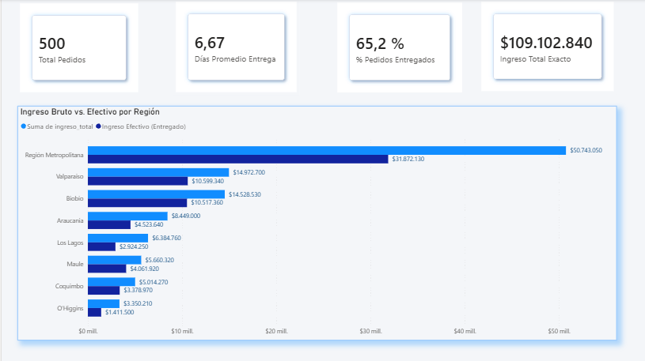
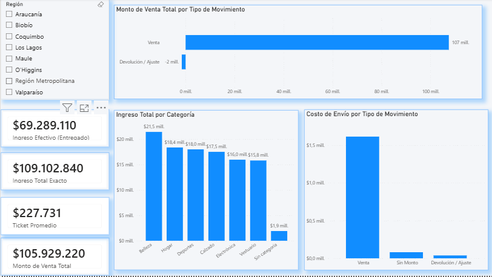

# ETL, Análisis Exploratorio y Dashboard Logístico (Python + Power BI)

## Descripción del Proyecto
Proyecto integral de análisis de datos (*end-to-end*) sobre un registro de **500 pedidos de e-commerce y despacho logístico** en Chile. Abarca desde el diagnóstico y limpieza de datos crudos en **Python (`pandas`, `numpy`)** hasta la construcción de un dashboard ejecutivo de 3 páginas en **Power BI** para el seguimiento de ingresos, lead time y pérdidas por cancelaciones o devoluciones.

## Estructura del Repositorio
* [`pedidos_logistica_raw.csv`](./pedidos_logistica_raw.csv): dataset original con inconsistencias de formato, fechas mixtas, valores negativos y nulos.
* [`etl_pedidos_logistica.ipynb`](./etl_pedidos_logistica.ipynb): pipeline ETL de limpieza, estandarización de texto/fechas, preservación de nulos y cálculo de métricas.
* [`pedidos_logistica_limpios.csv`](./pedidos_logistica_limpios.csv): dataset limpio (500 filas, 15 columnas) listo para análisis y BI.
* [`analisis_logistica.ipynb`](./analisis_logistica.ipynb): análisis exploratorio (ingreso bruto vs. efectivo, desempeño regional/categoría, evolución mensual y gráficos en `matplotlib`).
* [`dashboard_logistica_ventas.pbix`](./dashboard_logistica_ventas.pbix): informe interactivo de 3 páginas en Microsoft Power BI.
* [`capturas/`](./capturas): imágenes de las vistas principales del dashboard.

## Transformaciones Clave en el ETL
* **Limpieza financiera:** normalización de `monto_venta` eliminando símbolo `$`, sufijos `.0` y puntos de miles; clasificación en `Venta` (472), `Devolución / Ajuste` (7) y `Sin Monto` (21).
* **Cálculo seguro de ingresos:** uso de `costo_envio.fillna(0)` en ventas positivas para preservar el valor del producto cuando falta el costo de despacho.
* **Normalización preservando nulos:** unificación de 8 regiones, 6 categorías, clientes y 5 estados de entrega sin convertir los `NaN` reales en texto.
* **Fechas y Lead Time:** parseo seguro de formatos mixtos (`YYYY-MM-DD` y `DD/MM/YYYY`), cálculo de `dias_entrega` y aislamiento de 8 registros con fechas invertidas en `dias_entrega_limpio`.

## Principales Hallazgos
* **Ingreso Bruto vs. Efectivo:** de **109.102.840 CLP** en ventas registradas (`472` órdenes), **69.289.110 CLP** corresponden a pedidos efectivamente entregados (`326` órdenes, **65,2%**), mientras que **16.403.810 CLP** se perdieron en pedidos `Cancelado` (42) o `Devuelto` (25).
* **Concentración Regional:** la Región Metropolitana concentra el mayor volumen (**240 pedidos**) e ingreso efectivo (**31.872.130 CLP**), seguida por Valparaíso (**10.599.340 CLP**) y Biobío (**10.517.360 CLP**).
* **Tiempos de Entrega:** sobre **343 entregas válidas**, el lead time promedio es de **6,67 días** (mediana de **7,0 días**), variando entre **6,05 días** en Araucanía y **8,00 días** en Coquimbo.

## Dashboard en Power BI

### 1. Resumen Ejecutivo

### 2. Logística y Entregas

### 3. Finanzas y Costos

