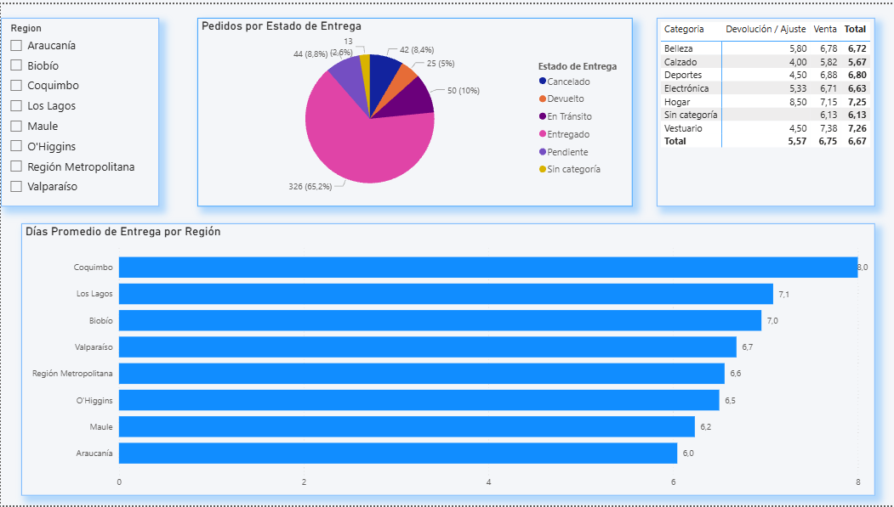

# Análisis de Logística, Ventas y Costos con Python y Power BI

Proyecto de análisis de datos de extremo a extremo sobre 500 pedidos logísticos, que abarca limpieza y transformación con Python (`pandas`, `numpy`), análisis exploratorio y un reporte multipágina en Power BI.

## Resumen de Métricas Clave
- **Total de pedidos:** 500
- **Ingreso total:** $102.537.860
- **Tipos de movimiento:** 472 ventas y 28 devoluciones / ajustes
- **Costo de envío total:** $1.732.360 ($1.613.600 en ventas y $118.760 en devoluciones / ajustes)[cite: 7]

## Estructura del Repositorio
- `pedidos_logistica_raw.csv`: dataset original con inconsistencias de formato, nulos y fechas mixtas[cite: 8, 12, 13].
- `pedidos_logistica_limpios.csv`: dataset procesado y estandarizado, listo para análisis y visualización[cite: 8, 12, 13].
- `etl_pedidos_logistica.ipynb`: notebook de limpieza, normalización, cálculo de métricas base y exportación del CSV limpio[cite: 8, 12, 13].
- `analisis_logistica.ipynb`: notebook de análisis exploratorio y agrupaciones por región, categoría y tipo de movimiento[cite: 8, 12, 13].
- `capturas/01-resumen-ejecutivo.png`: vista de Resumen Ejecutivo[cite: 9, 14].
- `capturas/02-logistica-entregas.png`: vista de Logística y Entregas[cite: 10, 14].
- `capturas/03-finanzas-costos.png`: vista de Finanzas y Costos[cite: 11, 14].
- `capturas/dashboard_logistica_ventas.pbix`: archivo del reporte en Power BI Desktop[cite: 14].

## Proceso ETL y Calidad de Datos (`etl_pedidos_logistica.ipynb`)
- Revisión inicial de estructura, tipos de datos, valores nulos y registros duplicados.
- Limpieza de `monto_venta` (eliminación de símbolos, separadores de miles y conversión numérica segura).
- Normalización de categorías, regiones y estados de entrega preservando valores faltantes reales.
- Cálculo de `ingreso_total` y clasificación por `tipo_movimiento` (`Venta` y `Devolución / Ajuste`).
- Parseo de fechas en distintos formatos, cálculo de `dias_entrega` y separación de valores negativos en `dias_entrega_limpio`.
- Ajuste de columnas numéricas clave a `Int64` y exportación a `pedidos_logistica_limpios.csv`[cite: 8, 12, 13].

## Análisis Exploratorio (`analisis_logistica.ipynb`)
- Validación de ingresos totales, monto de venta total, costos de envío y distribución por tipo de movimiento.
- Análisis por región y categoría para revisar volumen de pedidos, ingresos y tiempos promedio de entrega.

## Reporte en Power BI (`capturas/dashboard_logistica_ventas.pbix`)[cite: 14]
El archivo `.pbix` puede descargarse desde este repositorio y abrirse en Power BI Desktop[cite: 14]. Incluye tres páginas:

### 1. Resumen Ejecutivo
KPIs principales (`500` pedidos, `6,67` días promedio de entrega, `65,2 %` de pedidos entregados e ingreso total de `$102.537.860`) junto al desglose de ingresos por región[cite: 9].
[cite: 9, 14]

### 2. Logística y Entregas
Filtro por región, distribución de pedidos por estado de entrega, matriz de días promedio por categoría y tipo de movimiento, y días promedio de entrega por región[cite: 10].
[cite: 10, 14]

### 3. Finanzas y Costos
Tarjetas de Costo Envío Total (`$1.732.360`), Ingreso Total Exacto (`$102.537.860`), Ticket Promedio (`227.731`) y Monto de Venta Total (`$105.929.220`), acompañadas del monto por tipo de movimiento, ingreso por categoría y desglose del costo de envío por tipo de movimiento (`$1.613.600` en ventas y `$118.760` en devoluciones / ajustes)[cite: 7, 11].
[cite: 11, 14]
